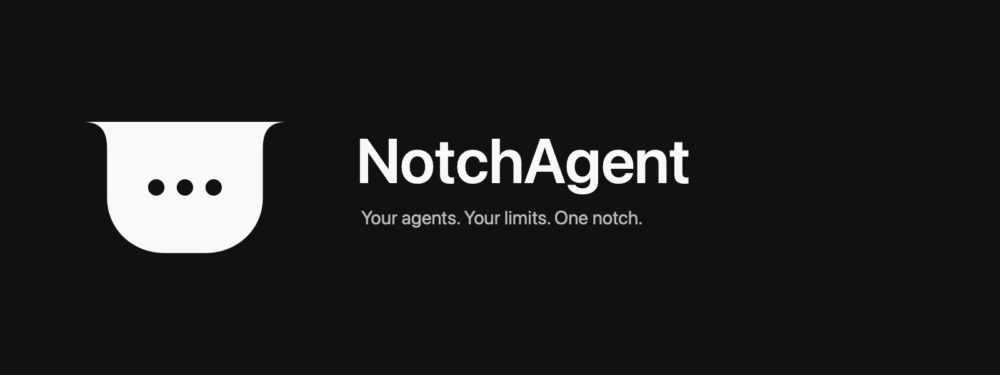

<div align="center">



**Your agents. Your limits. One notch.**

A private macOS companion for coding agents: usage limits, local model activity,
and session status in a compact notch at the edge of your screen.

</div>

NotchAgent is the private fork of [Codenotch](https://github.com/vinzdg/codenotch). It connects directly to the providers you enable and keeps transcript indexing off until you explicitly select accounts. Read [the network and privacy behavior](docs/privacy-provider-only.md) for the exact boundaries.

## Build and run

Requires Xcode, XcodeGen, and macOS 15 or later. The project targets Apple Silicon by default on this Mac.

```sh
make build DEV_SIGN='CODE_SIGN_IDENTITY="-" DEVELOPMENT_TEAM="" CODE_SIGN_STYLE=Automatic'
make run DEV_SIGN='CODE_SIGN_IDENTITY="-" DEVELOPMENT_TEAM="" CODE_SIGN_STYLE=Automatic'
```

Xcode users can generate the project with `make gen`, then open `NotchAgent.xcodeproj` and select the **NotchAgent** scheme. Local builds use ad-hoc signing. The application product is `NotchAgent.app`.

```sh
make test DEV_SIGN='CODE_SIGN_IDENTITY="-" DEVELOPMENT_TEAM="" CODE_SIGN_STYLE=Automatic'
```

## Settings

American English is the default app language and appears first as **English (US)**. Other languages and an explicit Follow System option remain available. Right-click the notch and choose **Recenter notch** to reset its position on the current edge; the reset is saved for future launches.

Open Settings with **⌘,**. General contains startup, app presence, language, and usage refresh. Accounts manages providers, with unused providers and optional configuration folded away. Appearance groups the notch's display, rings, position, size, and colors. Notifications controls delivery, agent activity, and limit alerts. Costs contains billing and local pricing. Privacy contains network information, history tracking, retention, and data removal. About contains the version, project source, and manual-update information.

## Privacy

- Built-in provider requests use exact approved origins, isolated sessions, and redirect rejection.
- Custom endpoints require an explicit origin; usage requests must stay on that origin.
- Upstream auto-updates, automatic remote pricing, embedded browser logins, and background CLI helpers are disabled.
- Transcript indexing is opt-in per account, with retention, Clear Local History, and coordinated Erase All Data controls.
- Data remains on this Mac except for the authentication and usage requests sent to connected providers.

The restrictions are enforced in app code. Manual links and sign-in commands open separate applications with their own network behavior. Local metadata is protected by file permissions and is not encrypted by the app. This is not an OS firewall guarantee.

## Branding

The selected identity is the monochrome **Inverse** notch mark. [The brand kit](Brand/NotchAgent/README.md) includes the icon master, light/dark vector marks, outlined wordmarks, banner, design directions, and a reproducible local generator.

Settings, menu items, notifications, translations, the Dock icon, build products, and packaging use **NotchAgent**. Legacy internal storage and credential identifiers remain compatible with existing installations. Provider logos retain their own identities.

## Other platforms

The repository includes the inherited Windows implementation. Its display branding and icon assets use NotchAgent, while its internal crate and storage identities remain compatible. The current privacy hardening and runtime verification apply to the macOS app; Windows requires its own security review before private use.

## License and acknowledgments

Based on Codenotch by Vinz and contributors. Original copyright notices and the [MIT license](LICENSE) are preserved. Provider assets retain their original licenses and notices. Historical design screenshots and release artifacts are retained as upstream archives, not presented as current NotchAgent builds.
